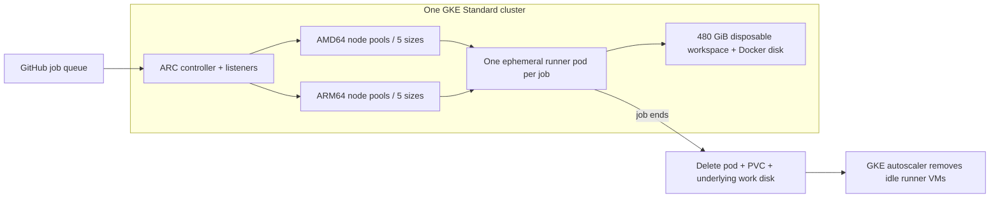

# GKE Actions Fleet

在**同一個 GKE Standard cluster** 執行不同尺寸、AMD64／ARM64 的 GitHub Actions runners。使用 GitHub 官方 Actions Runner Controller（ARC），透過具名 scale sets 接工作，runner pools 從 0 按需擴容，工作完成後縮回 0。MIT license，可獨立部署，不依賴特定公司的 repo。

One GKE cluster, named GitHub Actions runner sizes, native AMD64/ARM64, disposable 480 GiB job disks, and scale-to-zero worker pools.

## Runner 規格

每個規格各有 AMD64、ARM64 版本。名稱可在 `profiles` 中任意修改。

| vCPU | RAM | AMD64 `runs-on` | ARM64 `runs-on` | AMD64 / ARM64 並行上限 | 每個 job 工作磁碟 |
|---:|---:|---|---|---:|---:|
| 2 | 4 GiB | `gke-2cpu-4gb-amd64` | `gke-2cpu-4gb-arm64` | 16 / 16 | 480 GiB |
| 4 | 8 GiB | `gke-4cpu-8gb-amd64` | `gke-4cpu-8gb-arm64` | 16 / 16 | 480 GiB |
| 8 | 16 GiB | `gke-8cpu-16gb-amd64` | `gke-8cpu-16gb-arm64` | 16 / 8 | 480 GiB |
| 16 | 32 GiB | `gke-16cpu-32gb-amd64` | `gke-16cpu-32gb-arm64` | 16 / 8 | 480 GiB |
| 32 | 64 GiB | `gke-32cpu-64gb-amd64` | `gke-32cpu-64gb-arm64` | 16 / 8 | 480 GiB |

CPU/RAM 是 runner 容器的 requests 與 limits，單位為 vCPU/GiB；CPU 是 quota，並非固定實體核心。啟用 Docker 時，DinD 的 CPU／RAM limit 也跟隨同一規格，不會固定卡在 2 GiB；其基本 requests 為 250m CPU／512 MiB。Runner 與 DinD 共用同一台 VM 的實體容量，兩者不是各自獨立的一整台機器；同時執行重型 host 與 Docker 工作時，需一起評估總記憶體。Docker job／service containers 也可透過 `--cpus`／`--memory` 或 job container `options` 進一步限制。

## 架構與生命週期



- 一個常駐 system node 執行 ARC controller、listeners；10 種 runner 規格使用多個 node pools，各自 min=0。
- Job 排隊 → ARC 建立 runner pod → GKE 因 pending pod 建立對應機型／架構的 VM。
- 每個 runner 只處理一個 job；同一節點同時最多一個 runner，跨 namespace 亦同。
- 每個 job 配置獨立的 480 GiB PD Balanced 磁碟，workspace 與 Docker data 共用；generic ephemeral PVC 隨 pod 刪除，StorageClass 的 `reclaimPolicy: Delete` 再刪除底層磁碟。
- Runner VM 的 **30 GB OS boot disk 另外計費**，隨 GKE 刪除 VM 清除；system node 使用 50 GB boot disk。480 GiB 工作磁碟不含 OS，格式化後可用空間略少。
- **縮容與磁碟刪除是非同步的**。GKE 可能在數分鐘後刪除空閒 VM；這段時間可被下一個全新 runner pod 使用。沒有停止後保留的工作 VM／工作磁碟，也不保留跨 job 的 workspace。
- 持續有工作時節點可持續存在；只有閒置的 runner pools 歸零。GKE control plane、system node、Cloud NAT、日誌仍有基本費用。

## 工作磁碟容量與費用

預設每個 job 使用 **480 GiB PD Balanced**，workspace、工具快取與 Docker data 共用。全域 `workspace_gib` 可修改預設值，單一 `profiles.NAME.workspace_gib` 可再覆寫；接受 10–16384 的整數 GiB。調整設定後重新 render/install，新的 runner pod 使用新容量，`runs-on` 名稱不必改動。名稱尾綴本身不會動態增加磁碟。

```json
{
  "workspace_gib": 480,
  "profiles": {
    "gke-8cpu-16gb-amd64": {
      "workspace_gib": 640
    }
  }
}
```

以上為既有設定的局部修改示意，profile 仍需保留 CPU、RAM、機型等必要欄位。Runner 提供 `RUNNER_WORKSPACE_GIB` 環境變數供工作讀取配置容量。

以 [GCP PD Balanced 官方價格](https://cloud.google.com/compute/disks-image-pricing) US$0.000136986/GiB-hour 估算，480 GiB 約 **US$0.06575/磁碟小時**；相較 80 GiB 增加約 **US$0.05479/小時**，相較 240 GiB 增加約 **US$0.03288/小時**。例如累計 100 個磁碟小時，80→480 GiB 約增加 US$5.48。費率依地區與帳單調整；費用包含磁碟建立到刪除的期間，不只 job 執行時間。

StorageClass 允許擴容。更新 template 不會修改既有 PVC；執行中的 managed PVC 可由管理員另行線上擴容，不需刪除工作。容量只能增加，縮小設定只影響之後建立的 runner。節點 OS boot disk 容量獨立，變更工作磁碟不會增加 `/` 的容量。

## 快速部署

需要 Python 3.12+（本機 PR gate 測試另需 Node.js 18+）、OpenTofu 1.9+（測試版本 1.12.6）或相容 Terraform、Helm 3.17+/4、kubectl、gcloud 與 `gke-gcloud-auth-plugin`。GCP project 必須已啟用 billing，部署帳號能管理 GKE、Compute networking、service accounts、project IAM 與 API services。

```sh
cp config.example.json config.json
make setup
```

編輯 `config.json`：填入 project、region、zone、實際管理者出口 IP 的 CIDR，以及 GitHub organization URL。範例的 `203.0.113.10/32` 是文件用位址，**必須更換**。預設 `us-central1-a` 同時提供 N2、T2A；更換區域前確認兩種機型可用性與 quota。保留需要的 profiles，可調整名稱、機型、Docker 開關與併發上限。

`max_runners` 是該 GitHub target 的 scale set 上限，也是 **同一規格／架構所有 node pools 的合計容量預算**。多個 targets 競爭同一 pool；AMD64 與 ARM64 使用獨立 pools，不共用上限。依 CPU 2／4／8／16／32，AMD64 上限為 **16／16／16／16／16**（80 台），ARM64 為 **16／16／8／8／8**（56 台），合計最多 136 台 runner VM；只在有工作時建立。每個 pool 最小節點數仍為 0。控制服務使用一台 `e2-standard-4`，部署多個 targets 時需依 listeners 數量檢查 system node 容量。

```sh
gcloud auth application-default login
make validate
make plan
# 檢查 infra/runner.tfplan 的資源與費用後套用
tofu -chdir=infra apply runner.tfplan
gcloud container clusters get-credentials github-runners --zone us-central1-a --project YOUR_PROJECT
```

Terraform state 預設在本機且已被 gitignore。每個 GCP project 使用獨立 state；`terraform_data.deployment_identity` 會鎖定 project，誤用其他 project 的變數檔時，plan 應停止。Chart 驗證輸出使用 `build/validation/`，與部署用 `build/terraform.tfvars.json` 分開。多人操作前使用自己管理、具鎖定與存取控制的 remote backend。部署基礎設施與 Helm 分成兩步，避免 provider 在 cluster 尚未存在時連線失敗。

建立 GitHub App／runner group，依照 [GitHub 設定](docs/github.md) 取得 App ID、installation ID 與 PEM key。私鑰留在 repo 之外：

```sh
.venv/bin/python scripts/runnerctl.py create-secret \
  --target example --app-id 123456 --installation-id 654321 \
  --private-key /secure/path/github-app.pem
make install
```

Secret 透過 kubectl stdin 寫入，私鑰不放在 Helm values、Terraform state 或 command arguments。CLI 會使用設定所指定的 kube context，避免依賴目前選中的 cluster。`install` 先檢查所有 targets 的 Secret，再安裝 checksum 固定的官方 charts。

## 任意 repo 使用

授權該 repo 與受信任 workflow 使用 organization runner group 後，既有工作可以保留原本的 steps，只替換 `runs-on`。以下是可直接建立的完整手動執行範例：

```yaml
name: GKE CI
on:
  workflow_dispatch:
permissions:
  contents: read
jobs:
  test:
    runs-on:
      group: gke-runners
      labels: gke-8cpu-16gb-amd64
    timeout-minutes: 30
    steps:
      - run: uname -m
```

雙架構範例見 [examples/workflow.yml](examples/workflow.yml)。跨組織或獨立 repo 可新增 `targets`，每個 target 使用獨立 namespace 與 GitHub App Secret，仍共用同一 cluster 與 node pools。Organization runner group 權限不是任意跨組織的授權；repo target 不設定 `runner_group`。

雙架構的 YAML 可以使用固定規格加 architecture matrix：

```yaml
name: GKE AMD64 and ARM64
on:
  workflow_dispatch:
permissions:
  contents: read
jobs:
  test:
    strategy:
      matrix:
        architecture: [amd64, arm64]
    runs-on:
      group: gke-runners
      labels: ${{ format('gke-8cpu-16gb-{0}', matrix.architecture) }}
    timeout-minutes: 30
    steps:
      - run: uname -m
```

把完整 workflow 放進欲使用的 repo 的 `.github/workflows/`，並在 runner group 同時授權該 repo 與該 workflow 的受信任 branch ref。工作名稱只負責選資源，不代表有權使用 runner。上面的手動執行範例不可直接改成未設身分檢查的 PR trigger。

### 只有 organization member 的 PR 可以使用 GKE

請使用完整的 [examples/member-only-pr.yml](examples/member-only-pr.yml)，放到目標 repo 的 `.github/workflows/gke-member-pr.yml`；[設定手冊](docs/member-only-pr.md) 列出完整驗收步驟。

1. 建立獨立 GitHub App，僅授予 **Organization Members: read**，安裝至該 organization。
2. 在目標 repo／organization 設定 Actions variable `GKE_MEMBERSHIP_APP_ID`。建立 `gke-pr-admission` environment，只允許受保護的 base branch 部署，將 `GKE_MEMBERSHIP_APP_PRIVATE_KEY` **只放在該 environment secret**，不要另外複製到 repo／organization secrets，也不要使用 runner 管理 App 的私鑰。
3. 範例使用受信任 base branch 上的 `pull_request_target` workflow。GitHub-hosted admission job 不 checkout PR，會即時確認 PR 作者、觸發者與重新執行者都是 active org member。API 或憑證失敗時不啟動 GKE job。
4. Runner group 設成 **Selected repositories + Selected workflows**，例如只允許 `YOUR-ORG/YOUR-REPO/.github/workflows/gke-member-pr.yml@refs/heads/main`。`dev`／`master` 需同步修改 PR trigger、environment branch policy 與 workflow ref，並保護該 branch 的 workflow 變更。
5. 通過檢查才在 GKE checkout 核准的 PR head SHA，token 只有 `contents: read`、不保留 checkout credentials，也不傳入 membership／runner 私鑰。

外部 PR 可能產生輕量的 GitHub-hosted admission run／記錄，但不會獲得 GKE runner。只寫 `author_association` 或在 PR 可修改的 YAML 中加 `if:`，無法建立完整的存取邊界；必須搭配 runner group 的受信任 workflow allowlist。此範例需額外的 Members: read App 設定，複製檔案本身不會自動修改 organization 權限。

### Repository secrets、GitHub Environments 與完整工作流程功能

Fleet 使用 GitHub 官方 self-hosted runner，支援一般 Actions 的 repository／獲授權 organization secrets、variables、GitHub Environments、`GITHUB_TOKEN` permissions、OIDC、artifacts、cache、reusable workflows、Docker jobs 與 service containers。

使用 [examples/secrets-environment.yml](examples/secrets-environment.yml)，在 GKE job 本身宣告 environment 並明確傳入所需值：

```yaml
runs-on:
  group: gke-runners
  labels: gke-4cpu-8gb-amd64
environment: staging
permissions:
  contents: read
  id-token: write
env:
  API_TOKEN: ${{ secrets.DEPLOY_TOKEN }}
  API_URL: ${{ vars.API_URL }}
```

Repository secret 仍可用 `${{ secrets.NAME }}`；environment 的 secrets、variables、approval 與 branch rules 在該 job 上正常生效。另一個 job 的 environment 不會自動套用到 GKE job。GitHub 對 fork／Dependabot secrets 的限制仍適用；PR 入口保留前述成員驗證及受信任 workflow 限制。

預設 `allow_sudo: true`，可在 ephemeral runner container 內執行 `sudo apt-get`；設為 `false` 可停用提權。Runner 可寫層不再有固定 2 GiB 上限，實際空間仍受節點 OS 磁碟限制；480 GiB workspace／Docker disk 仍依 job 自動刪除。這些能力不需要把 operator ADC、runner 管理 App key 或 Kubernetes service-account token 交給 job。完整行為與 VM 層級界線見 [compatibility.md](docs/compatibility.md)。

## 同一規格使用多種機型

`machine_type` 是主要 pool；`alternatives` 可加入相同架構、資源足夠的機型／zone。工作仍使用同一個 `runs-on` 名稱，GKE autoscaler 可從相符的 pools 擴容：

```json
{
  "architecture": "amd64",
  "machine_type": "n2-custom-4-12288",
  "cpu": 2,
  "memory_gib": 4,
  "max_runners": 16,
  "spot": false,
  "docker": true,
  "alternatives": [{"machine_type": "n2d-standard-4", "max_nodes": 8}]
}
```

此例主要 pool 上限 8、替代 pool 上限 8，**加總 16**。`max_nodes` 是從同一份 profile budget 分配，不是額外增加。若某種機型無容量，只能使用其餘 pool 的配置額度；不會自動挪用其他 pool 的額度，因此不保證單一候選故障時仍能達到完整上限。需要調整配比時修改配置、檢查 plan 後套用。

範例 AMD64 使用 N2 custom + N2D；ARM64 使用不同 T2A 尺寸。16 CPU ARM 的替代 pool 與最大規格 ARM 的替代 pool 使用另一個 zone，降低單一 zone 的容量限制影響。額外 zone 必須位於相同 region 且有機型／quota。各機型都必須支援既有的 PD Balanced 工作磁碟；C4A 等僅支援 Hyperdisk 的系列不在目前候選清單中。完整候選加總滿載的 ARM 需求比只用主要機型更高，quota 必須按實際配置計算。

## 驗證

```sh
make test
make charts
```

本機測試驗證規格、架構匹配、資源餘裕、工作磁碟生命週期、隔離與清理判定。OpenTofu mock-provider 測試不建立雲端資源；chart 測試使用實際 ARC 0.15.1 charts，在 Kubernetes 1.32／1.35 模板條件下 render 全部 10 種規格並驗證 ARC CRD schema。這些檢查**不代表真實 GKE／GitHub E2E 已通過**。

導入後將 [examples/smoke.yml](examples/smoke.yml) 放進獲授權 repo 的 `.github/workflows/`，分別執行五種 size。每次驗證兩種架構、重複兩次、CPU/RAM cgroup limits、480 GiB disk、新工作區、Docker 與 Redis service container。等所有測試 job 結束後：

```sh
.venv/bin/python scripts/runnerctl.py wait-idle --timeout 1800
```

工具會檢查 runner pods、ephemeral runner CRs、PVCs、PVs、GCP 工作磁碟及 node-pool MIG 實例皆歸零，儲存 `build/idle-receipt.json`。它不將「沒有 Kubernetes Node」當成「VM 已刪除」，也不保留 JIT credentials。GitHub API 的 runner registrations／job 結果需另外依 [營運手冊](docs/operations.md) 讀回。

## 現有專案遷移

```sh
.venv/bin/python scripts/audit_workflows.py \
  --root ~/code --pattern 'your-project*' --out build/migration-inventory.json
```

工具唯讀盤點 workflows，去除 git worktree 重複項；報告放在 gitignored `build/`，避免將內部 repo 資訊放進 OSS。支援依據見 [遷移手冊](docs/migration.md)，包含原生編譯、Python/Node、Playwright、Docker、舊 labels 與回退流程。

## 支援範圍

這是**同一信任邊界內的 Linux CI**。Docker 使用 privileged DinD；NetworkPolicy 與 namespace 不提供敵意多租戶 VM 級隔離。公開此專案原始碼不表示應開放 runner 給未審查的 fork PR。macOS、Windows、GPU 與不受信任租戶的隔離另行規劃。預設無工作負載 GCP 權限；部署 jobs 使用 GitHub OIDC／明確的工作負載身分。

固定版本與 image digests 位於 `scripts/runnerctl.py`。更新 runner 需跟上 GitHub 的支援週期；更新 ARC 時同步更新兩個 charts、checksums、CRDs 及驗證紀錄，詳見營運手冊。

同一 organization 的一般／保護工作可使用不同 targets、namespace、App Secret 與 scale-set 名稱；`targets.NAME.runner_image` 支援各 target 使用不同的 digest-pinned image，`scale_set_prefix: "gkp-"` 可將內建 `gke-*` 名稱轉為獨立的 `gkp-*`。私有 Artifact Registry 的 pull 權限可用 `artifact_registry_repositories` 明確設定 repository-level reader。操作與權限邊界見 [targets.md](docs/targets.md)；安裝不會重設 GitHub runner group 的既有 allowlist。

目前已完成與待完成的檢查見 [validation status](docs/validation.md)。

公開發布與憑證處理規則見 [SECURITY.md](SECURITY.md)。請只發布 Git 中經檢查的原始碼；本機 `build/`、實際設定與 Terraform state 不應隨整個工作資料夾打包公開。
